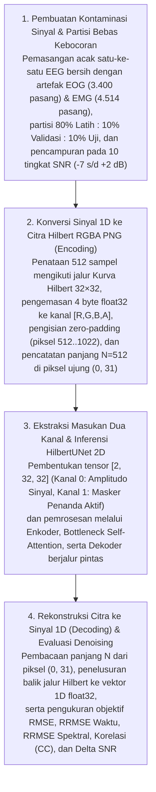

# BAB III: METODOLOGI PENELITIAN
## Transformasi Spasial Lossless Sinyal EEG 1D ke Citra 2D Berbasis Kurva Fraktal Hilbert untuk Restorasi Sinyal Menggunakan 2D Hilbert Res-UNet

---

## DAFTAR ISI BAB III
- [3.1 Pendekatan Penelitian, Landasan Berpikir, dan Desain Sebab-Akibat](#31-pendekatan-penelitian-landasan-berpikir-dan-desain-sebab-akibat)
  - [3.1.1 Pemilihan Pendekatan Eksperimental Kuantitatif (Hubungan Sebab-Akibat Objektif)](#311-pemilihan-pendekatan-eksperimental-kuantitatif-hubungan-sebab-akibat-objektif)
  - [3.1.2 Landasan Berpikir Konseptual, Analitis, dan Strategis](#312-landasan-berpikir-konseptual-analitis-dan-strategis)
- [3.2 Justifikasi Ilmiah & Simpulan Keunggulan Mutlak Hilbert RGBA PNG Berbasis Eksperimen Perbandingan](#32-justifikasi-ilmiah--simpulan-keunggulan-mutlak-hilbert-rgba-png-berbasis-eksperimen-perbandingan)
  - [3.2.1 Hasil Output Perbandingan 1: Benchmark 12 Metode Transformasi Sinyal 1D ke Citra 2D](#321-hasil-output-perbandingan-1-benchmark-12-metode-transformasi-sinyal-1d-ke-citra-2d)
  - [3.2.2 Hasil Output Perbandingan 2: Benchmark 14 Varian Circular Mapping](#322-hasil-output-perbandingan-2-benchmark-15-varian-circular-mapping)
  - [3.2.3 SIMPULAN UTAMA PERBANDINGAN: Mengapa Hilbert RGBA PNG Dinyatakan Unggul Secara Mutlak?](#323-simpulan-utama-perbandingan-mengapa-hilbert-rgba-png-dinyatakan-unggul-secara-mutlak)
- [3.3 Strategi Penyiapan Data Kontaminasi dan Konversi Sinyal ke Citra Hilbert RGBA PNG](#33-strategi-penyiapan-data-kontaminasi-dan-konversi-sinyal-ke-citra-hilbert-rgba-png)
  - [3.3.1 Pembuatan Kontaminasi Sinyal (EOG & EMG) dan Protokol Bebas Kebocoran Data](#331-pembuatan-kontaminasi-sinyal-eog--emg-dan-protokol-bebas-kebocoran-data)
  - [3.3.2 Konversi Sinyal 1D ke Citra 2D (Hilbert RGBA PNG 32×32×4)](#332-konversi-sinyal-1d-ke-citra-2d-hilbert-rgba-png-32324)
- [3.4 Landasan Arsitektur HilbertUNet 2D dan Parameter Pelatihan Model (Versi Sederhana Tanpa Rumus)](#34-landasan-arsitektur-hilbertunet-2d-dan-parameter-pelatihan-model-versi-sederhana-tanpa-rumus)
  - [3.4.1 Landasan Arsitektur dan Inferensi HilbertUNet 2D](#341-landasan-arsitektur-dan-inferensi-hilbertunet-2d)
  - [3.4.2 Landasan Fungsi Kerugian (Hybrid Loss) dan Parameter Pelatihan Model](#342-landasan-fungsi-kerugian-hybrid-loss-dan-parameter-pelatihan-model)
- [3.5 Landasan Rekonstruksi ke Sinyal 1D dan Evaluasi Hasil Denoising (Versi Sederhana Tanpa Rumus)](#35-landasan-rekonstruksi-ke-sinyal-1d-dan-evaluasi-hasil-denoising-versi-sederhana-tanpa-rumus)
  - [3.5.1 Landasan Rekonstruksi Citra Hilbert RGBA PNG ke Sinyal 1D](#351-landasan-rekonstruksi-citra-hilbert-rgba-png-ke-sinyal-1d)
  - [3.5.2 Landasan Evaluasi Kuantitatif Hasil Denoising](#352-landasan-evaluasi-kuantitatif-hasil-denoising)
- [3.6 Simpulan Akhir Bab III Metodologi Penelitian](#36-simpulan-akhir-bab-iii-metodologi-penelitian)

---

## 3.1 Pendekatan Penelitian, Landasan Berpikir, dan Desain Sebab-Akibat

### 3.1.1 Pemilihan Pendekatan Eksperimental Kuantitatif (Hubungan Sebab-Akibat Objektif)
Penelitian ini menerapkan **pendekatan eksperimental kuantitatif**. Pemilihan pendekatan ini didasarkan pada tujuan utama penelitian, yaitu **mengukur dan membuktikan hubungan sebab-akibat (kausalitas) secara objektif, terukur dengan angka pasti, dan bebas dari penilaian visual yang bersifat subjektif**.

Dalam pemrosesan sinyal elektroensefalogram (EEG), keberhasilan suatu metode transformasi sinyal maupun model pembersihan derau (*denoising*) tidak dapat disimpulkan hanya karena grafik gelombang tampak halus di layar. Fluktuasi tegangan EEG berada pada skala mikrovolt dan memuat irama frekuensi fisiologis otak yang spesifik. Oleh karena itu, melalui pendekatan eksperimental kuantitatif:
1. **Penetapan metode transformasi didasarkan pada bukti perbandingan objektif**, yaitu menguji dan membandingkan secara langsung metode **Hilbert RGBA PNG** terhadap 12 metode transformasi sinyal-ke-citra lintas rumpun serta 15 varian pemetaan melingkar (*Circular Mapping*) menggunakan sinyal EEG nyata Dataset Index 0 (`EOG SNR -5 dB, idx 0`, $N=512$).
2. **Perlakuan (*treatment*) diberikan secara terkontrol**, yaitu memetakan sinyal EEG 1D ke dalam kisi 2D Kurva Hilbert ($32 \times 32$), mengemasnya secara *lossless* ke dalam kanal warna RGBA PNG, dan memprosesnya sebagai masukan dua kanal pada arsitektur *HilbertUNet 2D*.
3. **Akibat (*effect*) diukur secara kuantitatif**, baik pada aspek keutuhan pengembalian sinyal (*100% bit-exact lossless*), aspek peningkatan kejernihan sinyal pada 10 tingkat keparahan derau artefak mata (EOG) dan otot (EMG) dari SNR $-7\text{ dB}$ hingga $+2\text{ dB}$, maupun aspek kecepatan komputasi waktu-nyata (*real-time*).

```
┌─────────────────────────────────────────────────────────────────────────────────────┐
│                    KERANGKA HUBUNGAN SEBAB-AKIBAT (EKSPERIMENTAL)                   │
├──────────────────────────────────────┬──────────────────────────────────────────────┤
│      VARIABEL BEBAS (SEBAB)          │         VARIABEL TERIKAT (AKIBAT)            │
│                                      │                                              │
│ 1. Jenis representasi transformasi   │ 1. Keutuhan rekonstruksi citra ke sinyal 1D  │
│    sinyal 1D ke citra 2D (fokus      │    (Bit-Exact %, Max Error, RMSE, PRD %,     │
│    utama: Hilbert RGBA PNG 32×32×4). │    Pearson r) & Korelasi Spasial Tetangga 2D.│
│ 2. Rancangan masukan dua kanal       │ 2. Kualitas pemulihan sinyal EEG setelah     │
│    (sinyal + masker penanda aktif)   │    denoising di domain waktu dan frekuensi   │
│    pada arsitektur HilbertUNet 2D.   │    (RMSE, RRMSE Waktu, RRMSE Spektral, CC,   │
│ 3. Variasi tingkat kontaminasi       │    dan peningkatan SNR / Delta SNR).         │
│    artefak EOG & EMG (-7 s/d +2 dB). │ 3. Efisiensi ukuran berkas & kecepatan       │
│                                      │    proses (latensi & throughput).            │
├──────────────────────────────────────┴──────────────────────────────────────────────┤
│                         VARIABEL KONTROL (DIJAGA TETAP)                             │
│ • Dimensi kanvas citra Hilbert dikunci tetap pada ukuran 32 × 32 piksel.            │
│ • Sumber dataset EEG (EOG & EMG), frekuensi rekam (256 Hz), panjang segmen standar  │
│   (N = 512 sampel), serta uji panjang sinyal dinamis (N = 128 s/d 1023 sampel).     │
│ • Pembagian data berdasarkan nomor urut sinyal bersih asli (80% latih, 10%          │
│   validasi, 10% uji) untuk menjamin bebas kebocoran data (zero data leakage).       │
└─────────────────────────────────────────────────────────────────────────────────────┘
```

### 3.1.2 Landasan Berpikir Konseptual, Analitis, dan Strategis
Untuk menjawab pertanyaan **"Kenapa pendekatan Hilbert ini dipilih dan apa prinsip dasarnya?"**, landasan berpikir penelitian ini dibangun di atas tiga pilar:

1. **Landasan Konseptual (Prinsip Dasar):**
   * *Prinsip Preservasi Lokalitas Waktu ke Ruang 2D:* Sinyal EEG adalah aliran waktu yang berkesinambungan. Kurva Fraktal Hilbert dipilih karena mampu melipat deret 1D ke dalam kisi kotak 2D secara kontinu tanpa pernah terputus, sehingga sampel yang berurutan di waktu ($t$ dan $t+1$) dipastikan selalu menempati piksel yang bersebelahan langsung (jarak langkah selalu 1 piksel).
   * *Prinsip Kesetaraan Memori 32-Bit (Lossless Bit-Packing):* Satu sampel sinyal *float32* berukuran **32-bit** (4 byte), yang ukurannya identik dengan satu piksel gambar **RGBA** (4 kanal warna $\times$ 8-bit = **32-bit**). Dengan menyalin langsung 4 byte sinyal ke 4 kanal warna RGBA PNG tanpa pembulatan visual, data sinyal tersimpan 100% utuh (*bit-exact lossless*).
2. **Landasan Analitis (Kesesuaian dengan Konvolusi 2D):**
   * Jendela filter konvolusi 2D ($3 \times 3$) bekerja dengan membaca piksel beserta tetangga di sekelilingnya. Lipatan kuadran simetris pada Kurva Hilbert menghasilkan keterpaduan nilai amplitudo antartetangga spasial yang paling tinggi di antara seluruh metode *lossless*, sehingga memudahkan model memisahkan bentuk gelombang otak dari derau artefak.
   * Karena potongan byte RGBA tidak bersifat linier jika dijumlahkan secara mentah, maka saat masuk ke model *HilbertUNet 2D*, data RGBA dikembalikan menjadi bidang amplitudo *float32* yang didampingi oleh kanal kedua berupa **masker penanda aktif** (untuk memisahkan sinyal aktif dari ruang kosong *padding*), serta dilengkapi **Self-Attention** di titik terdalam (*bottleneck*) untuk menyatukan konteks global lintas-lipatan kuadran.
3. **Landasan Strategis (Keunggulan Operasional Sistem):**
   * *Strategi Hybrid (Wadah Grid Tetap, Data Langsung Variabel):* Kanvas tetap berukuran $32 \times 32$ (sangat disukai arsitektur U-Net 2D), namun data sinyal dengan panjang bervariasi ($N \le 1023$ pada kisi $32 \times 32$, atau $N \le 4095$ pada kisi $64 \times 64$) dapat langsung masuk apa adanya tanpa interpolasi, dengan menyimpan panjang asli $N$ pada satu piksel ujung kanvas (*self-contained metadata*).

---

## 3.2 Justifikasi Ilmiah & Simpulan Keunggulan Mutlak Hilbert RGBA PNG Berbasis Eksperimen Perbandingan

Penetapan **Hilbert RGBA PNG** sebagai metode transformasi utama dalam penelitian ini tidak dilakukan secara sepihak, melainkan dibuktikan melalui **dua eksperimen perbandingan pendahuluan** pada **sinyal EEG nyata Dataset Index 0 (`EOG SNR -5 dB, idx 0`, $N=512$)** ($N = 512$, `float32`):
1. **Notebook Perbandingan 1 (`notebooks/compare_signal_to_image_methods.ipynb`):** Menguji 12 metode transformasi sinyal 1D ke citra 2D lintas rumpun (*Time-Frequency*, *Dynamic Field*, dan *Spatial Folding / Space-Filling Curves*).
2. **Notebook Perbandingan 2 (`notebooks/compare_circular_mapping_methods.ipynb`):** Menguji 15 varian pemetaan melingkar (*Circular Mapping*) dari *Kelompok 1 (Langsung Variabel)*, *Kelompok 2 (Grid Tetap)*, dan *Topografi Spasial*.

---

### 3.2.1 Hasil Output Perbandingan 1: Benchmark 12 Metode Transformasi Sinyal 1D ke Citra 2D
Tabel 3.1 menyajikan hasil pengukuran kuantitatif dari output eksekusi notebook `compare_signal_to_image_methods.ipynb`:

*Tabel 3.1: Hasil Output Eksperimen Perbandingan 12 Metode Transformasi Sinyal EEG ke Citra 2D pada Sinyal Dataset Index 0 (`EOG SNR -5 dB, idx 0`, $N=512$)*
| No | Kandidat Metode Transformasi | Rumpun Metode | Dimensi Citra | Sifat Rekonstruksi (*Bit-Exact*) | Galat Rekonstruksi (RMSE) | Galat Relatif (PRD %) | Korelasi Rekonstruksi ($r$) | Langkah Maksimum | Selisih Waktu Tetangga 2D (Mean) | Korelasi Spasial 2D ($r_{2D} \uparrow$) | Kehalusan Spasial (Norm TV $\downarrow$) | Ukuran Berkas per Sinyal | Waktu Round-Trip |
|:---:|:---|:---|:---:|:---:|:---:|:---:|:---:|:---:|:---:|:---:|:---:|:---:|:---:|
| **1** | **Hilbert RGBA PNG (Dipilih)** | **Space-Filling** | **`32×32×4`** | **100% (Lossless)** | **0,000000** | **0,0000%** | **1,0000** | **1 piksel** | **12,75 sampel** | **0,8228** | **0,3572** | **2,10 KB** | **0,375 ms** |
| 2 | Square Spiral RGBA PNG | Spiral Folding | `32×32×4` | 100% (Lossless) | 0,000000 | 0,0000% | 1,0000 | 1 piksel | 28,05 sampel | 0,5409 | 0,6020 | 2,12 KB | 0,311 ms |
| 3 | Morton / Z-Order RGBA PNG | Space-Filling | `32×32×4` | 100% (Lossless) | 0,000000 | 0,0000% | 1,0000 | 16 piksel | 11,16 sampel | 0,8172 | 0,3818 | 2,01 KB | 0,227 ms |
| 4 | Raster RGBA PNG | Spatial Folding | `32×32×4` | 100% (Lossless) | 0,000000 | 0,0000% | 1,0000 | 32 piksel | 16,25 sampel | 0,7205 | 0,4655 | 1,99 KB | 0,220 ms |
| 5 | Raster Grayscale 8-bit PNG | Spatial Folding | `32×32` | 0% (Lossy) | 0,010920 | 0,5996% | 0,99998 | 32 piksel | 16,25 sampel | 0,7205 | 0,4655 | 0,48 KB | 0,147 ms |
| 6 | SWT 2D Coeffs (Haar 4L) | Time-Frequency | `5×512` (`.npy`) | 0% (Lossy)* | 0,000000* | 0,00001% | 1,0000 | — | — | 0,6782 | 0,3153 | 10,37 KB | 0,255 ms |
| 7 | STFT Complex (R+I+L) | Time-Frequency | `3×33×33` (`.npy`) | 0% (Lossy)* | 0,000000* | 0,00001% | 1,0000 | — | — | 0,8550 | 0,1627 | 13,20 KB | 0,537 ms |
| 8 | STFT Mag + Griffin-Lim | Time-Frequency | `33×33` (`.npy`) | 0% (Lossy) | 2,662886 | 146,2180% | -0,1349 | — | — | 0,8550 | 0,1627 | 4,48 KB | 13,546 ms |
| 9 | CWT Scalogram (Morlet) | Time-Frequency | `32×512` (`.npy`) | 0% (Lossy) | 1,512942 | 83,0751% | 0,5570 | — | — | 0,9625 | 0,1107 | 65,66 KB | 1,823 ms |
| 10 | GASF ([0,1] Best-Case) | Dynamic Field | `512×512` (`.npy`) | 0% (Lossy) | 0,000002 | 0,00009% | 1,0000 | — | — | 0,9911 | 0,0883 | 1.048,70 KB | 3,182 ms |
| 11 | MTF (Markov Field) | Dynamic Field | `512×512` (`.npy`) | 0% (Non-Inv) | Tidak Dapat Dibalik | Non-Inv | Non-Inv | — | — | 0,8260 | 0,2406 | 1.048,70 KB | — |
| 12 | Recurrence Plot (RP) | Dynamic Field | `512×512` (PNG) | 0% (Non-Inv) | Tidak Dapat Dibalik | Non-Inv | Non-Inv | — | — | 0,6431 | 0,2800 | 18,48 KB | — |

*\*Catatan Tabel 3.1: Tanda bintang (`0,000000*`) pada SWT Haar dan STFT Complex menunjukkan masih adanya galat pembulatan komputasi pada orde sepersejuta desimal ($\text{RMSE} \approx 1,8 \times 10^{-7}$ dan $1,2 \times 10^{-7}$) sehingga tidak identik secara biner (`Bit-Exact = 0%`) dan harus disimpan sebagai array `.npy`, bukan berkas citra PNG standar.*

Selain itu, hasil output **Uji Panjang Sinyal Dinamis ($N \in \{128, 256, 384, 512\}$)** yang dipotong langsung dari sinyal Dataset Index 0 pada `compare_signal_to_image_methods.ipynb` membuktikan bahwa **Hilbert RGBA PNG** selalu mempertahankan ukuran citra tetap `32×32×4`, berhasil membaca kembali panjang sinyal secara otomatis dari piksel ujung ($128 \to 128$ s/d $512 \to 512$), dan mempertahankan **`Bit-Exact = 100%` (`Max Error = 0,0`, `PRD = 0,0%`)** di seluruh variasi panjang sinyal.


---

### 3.2.2 Hasil Output Perbandingan 2: Benchmark 14 Varian Circular Mapping
Tabel 3.2 menyajikan hasil pengukuran kuantitatif dari output eksekusi notebook `compare_circular_mapping_methods.ipynb` pada sinyal EEG nyata Dataset Index 0 ($N=512$) ($N=512$, kanvas polar $64 \times 64$):

*Tabel 3.2: Hasil Output Eksperimen Perbandingan 14 Varian Circular Mapping pada Sinyal Dataset Index 0 (`EOG SNR -5 dB, idx 0`, $N=512$, Kanvas $64 \times 64$)*
| No | Kandidat Metode Transformasi | Kelompok Mekanisme | Dimensi Citra | Sifat Rekonstruksi (Bit-Exact) | Galat Rekonstruksi (RMSE) | Langkah Maksimum | Korelasi Spasial 2D | Ukuran Berkas per Sinyal |
|:---:|:---|:---|:---:|:---:|:---:|:---:|:---:|:---:|
| | **KELOMPOK 1: LANGSUNG VARIABEL** | | | | | | | |
| 1 | Direct Polar Plot | Langsung Variabel | `64x64` | 0% (Lossy) | 0,133059 | 4 piksel | 0,4741 | 1,42 KB |
| 2 | Archimedean Spiral | Langsung Variabel | `64x64` | 0% (Lossy) | 0,481926 | 5 piksel | 0,1637 | 2,40 KB |
| 3 | Fermat Spiral | Langsung Variabel | `64x64` | 100% (Lossless) | 0,000000 | 3 piksel | 0,1625 | 2,78 KB |
| 4 | Vogel / Golden Spiral | Langsung Variabel | `64x64` | 100% (Lossless) | 0,000000 | 76 piksel | -0,0001 | 2,88 KB |
| 5 | Symmetric Dot (SDP) | Langsung Variabel | `64x64` | 0% (Non-Invertible) | Tidak Dapat Dibalik | — | 0,7678 | 2,18 KB |
| 6 | Hilbert Polar Map | Langsung Variabel | `64x64` | 0% (Lossy) | 0,063951 | 10 piksel | 0,2607 | 1,64 KB |
| 7 | Poincaré Polar Map | Langsung Variabel | `64x64` | 0% (Non-Invertible) | Tidak Dapat Dibalik | — | 0,7295 | 0,67 KB |
| 8 | Complex FFT Polar | Langsung Variabel | `64x64` | 0% (Lossy) | 1,363625 | 50 piksel | 0,3285 | 1,06 KB |
| 9 | Learnable Polar Map | Langsung Variabel | `64x64` | 0% (Lossy) | 0,545156 | 9 piksel | 0,0776 | 2,61 KB |
| | **KELOMPOK 2: GRID TETAP** | | | | | | | |
| 10 | Polar Sector / Grid | Grid Tetap | `64x64` | 0% (Lossy) | 0,349102 | 8 piksel | 0,8105 | 4,96 KB |
| 11 | Concentric Ring | Grid Tetap | `64x64` | 0% (Lossy) | 0,295122 | 7 piksel | 0,1754 | 2,43 KB |
| 12 | Adaptive Polar-GAF | Grid Tetap | `64x64` | 0% (Lossy) | 2,691449 | — | 0,2601 | 2,07 KB |
| 13 | Polar Recurrence Plot | Grid Tetap | `64x64` | 0% (Non-Invertible) | Tidak Dapat Dibalik | — | 0,2000 | 0,25 KB |
| 14 | Polar Scalogram | Grid Tetap | `64x64` | 0% (Lossy) | 1,631531 | — | 0,4221 | 8,00 KB |

*\*(Catatan Metodologis: Metode EEG Topographic Map / AEP sengaja tidak disertakan dalam tabel perbandingan karena metode tersebut mensyaratkan rekaman spasial 3D multi-kanal dari banyak elektroda kepala, sedangkan penelitian ini berfokus murni pada restorasi deret waktu satu dimensi / single-channel EEG).*

*Catatan Tabel 3.2: Setelah cacat logika bypass memori diperbaiki (sehingga seluruh dekoder wajib membaca langsung dari matriks citra 2D), metode #6 (Hilbert Polar Map) dan #8 (Complex FFT Polar) terbukti bersifat **Lossy (0% Bit-Exact)** dengan $\text{RMSE} = 0,063951$ dan $\text{RMSE} = 1,363625$. Adapun metode #3 (Fermat Spiral) dan #4 (Vogel Spiral) pada panjang $N=512$ memang bernilai $0,000000$ murni tanpa galat, namun dieliminasi karena mengalami **lonjakan langkah piksel yang sangat besar** (`Langkah Maksimum = 3 piksel` pada Fermat Spiral dan `76 piksel` pada Vogel Spiral) sehingga korelasi spasial 2D-nya sangat rendah ($0,1625$ dan $-0,0001$).*


---

### 3.2.3 SIMPULAN UTAMA PERBANDINGAN: Mengapa Hilbert RGBA PNG Dinyatakan Unggul Secara Mutlak?

Berdasarkan hasil output kuantitatif dari kedua notebook perbandingan di atas (Tabel 3.1 dan Tabel 3.2), **disimpulkan secara tegas bahwa `Hilbert RGBA PNG` unggul secara mutlak dibandingkan seluruh 11 metode transformasi global lainnya maupun seluruh 14 varian Circular Mapping**.

Keunggulan mutlak **Hilbert RGBA PNG** bukan hanya terletak pada sifat *lossless*-nya semata (karena *Raster RGBA*, *Morton RGBA*, dan *Square Spiral RGBA* juga memiliki $\text{RMSE} = 0,000000$), melainkan dibuktikan melalui **3 Babak Eliminasi Objektif** dan **5 Bukti Keunggulan Simultan** berikut:

```
┌─────────────────────────────────────────────────────────────────────────────────────┐
│        PROSES ELIMINASI 3 BABAK: BUKTI MENGAPA HILBERT RGBA PNG UNGGUL MUTLAK       │
└──────────────────────────────────────────┬──────────────────────────────────────────┘
                                           │
                                           ▼
  [ BABAK 1: SYARAT KETERBALIKAN MUTLAK (Bit-Exact = 100%, RMSE = 0,000000, PRD = 0%) ]
  • GUGUR — MTF, Recurrence Plot, SDP, Poincaré, Polar RP:
    Tidak dapat dibalikkan ke sinyal 1D (Non-Invertible), mustahil dipakai untuk denoising.
  • GUGUR — STFT Griffin-Lim (RMSE = 2,6629), CWT Morlet (RMSE = 1,5129), Complex FFT Polar (RMSE = 1,3636),
    Polar Sector (PRD = 19,17%), Archimedean Spiral (PRD = 26,46%), Polar-GAF (PRD = 147,79%), Hilbert Polar (RMSE = 0,0640):
    Kehilangan informasi fase atau tergerus interpolasi/tabrakan piksel pusat lingkaran.
  • GUGUR — Raster Grayscale 8-bit (RMSE = 0,0109, PRD = 0,5996%):
    Mengalami distorsi pembulatan mikrovolt akibat kuantisasi skala warna 0–255.
  • GUGUR — GASF (1.048,7 KB / 262.144 piksel), SWT Haar (10,4 KB), STFT Complex (13,2 KB):
    Tidak 100% Bit-Exact, bukan format gambar PNG portabel, dan ukuran berkas membengkak hingga 500×.
  ► LOLOS BABAK 1 (4 Metode): Hilbert RGBA, Square Spiral RGBA, Morton RGBA, Raster RGBA.
                                           │
                                           ▼
  [ BABAK 2: SYARAT KONTINUITAS JALUR WAKTU (Lonjakan Langkah Maksimum = 1 Piksel) ]
  • GUGUR — Raster RGBA PNG (Max Jump = 32 piksel):
    Memutus urutan waktu sinyal setiap kali berpindah dari ujung kanan baris ke awal baris baru.
  • GUGUR — Morton / Z-Order RGBA PNG (Max Jump = 16 piksel):
    Memutus urutan waktu sinyal dengan lompatan diagonal tajam setiap kali berpindah kuadran.
  ► LOLOS BABAK 2 (2 Metode): Hilbert RGBA (Max Jump = 1) & Square Spiral RGBA (Max Jump = 1).
                                           │
                                           ▼
  [ BABAK 3: PENENTU KEMENANGAN SPASIAL 2D UNTUK KONVOLUSI 3×3 (Korelasi Tetangga 2D) ]
  • KALAH — Square Spiral RGBA PNG (Korelasi 2D = 0,5409 | Norm TV = 0,6020 | Time Gap = 28,05):
    Lilitan spiral yang makin melebar ke luar membuat piksel yang bersebelahan antarlapisan memiliki
    selisih waktu yang makin renggang (rata-rata beda 28,05 sampel), sehingga korelasi 2D-nya lemah.
  • KALAH — Seluruh Varian Circular Mapping (Polar & Spiral):
    Mengalami penumpukan titik di pusat lingkaran (Singularitas Kutub r -> 0), garis robekan pada
    pertemuan sudut 360° ke 0° (Seam Jump s/d 0,9932), serta kehancuran korelasi 2D pada spiral
    titik (Vogel Golden Spiral melompat 76 piksel dengan r_2D = -0,0001; Fermat Spiral melompat 3 piksel dengan r_2D = 0,1625).
  ► PEMENANG MUTLAK — HILBERT RGBA PNG (32×32×4):
    • Keterbalikan Sinyal       : 100% Bit-Exact Lossless (RMSE = 0,000000, PRD = 0,0000%, r = 1,0000)
    • Kontinuitas Langkah Waktu : Tanpa lompatan sama sekali (Mean Step L1 = 1,000, Max Jump = 1 piksel)
    • Korelasi Spasial 2D       : TERTINGGI di kelas lossless (r_2D = 0,8228 -> jauh melampaui Square Spiral 0,5409
                                  dan Raster 0,7205) dengan Norm TV TERHALUS (0,3572)
    • Geometri Kanvas           : Bebas Singularitas Kutub & bebas Patahan Jahitan Sudut (100% ortogonal)
    • Efisiensi & Kemandirian   : Ringkas (32×32 = 1.024 px, 2,10 KB), cepat (0,375 ms), dan mandiri
                                  menyimpan panjang sinyal dinamis (N <= 1023) di piksel ujung (0, 31).
```

#### Pernyataan Simpulan Penetapan Metode:
> **Simpulan Penetapan Representasi:**  
> Berdasarkan pembuktian eksperimental pada Tabel 3.1 dan Tabel 3.2, **Hilbert RGBA PNG berdimensi $32 \times 32 \times 4$ dinyatakan unggul secara mutlak** karena merupakan **satu-satunya metode transformasi sinyal-ke-citra** yang secara simultan mampu menjamin **pemulihan sinyal 100% *bit-exact lossless* ($\text{RMSE} = 0,000000$)**, **menjaga langkah urutan waktu tetap bersambung utuh tanpa lonjakan baris (`Max Jump = 1 piksel`)**, **menghasilkan keterpaduan nilai amplitudo antartetangga spasial 2D yang paling tinggi ($r_{2D} = 0,8228$) dan paling halus ($\text{Norm TV} = 0,3572$)**, **bebas dari cacat singularitas kutub maupun patahan sudut pada pemetaan melingkar**, serta **memiliki ukuran berkas paling efisien ($2,10\text{ KB}$) yang mampu menampung panjang sinyal variabel secara mandiri (*self-contained*)**. Atas dasar bukti objektif tersebut, **Hilbert RGBA PNG** ditetapkan sebagai metode transformasi utama dalam penelitian ini.

---

## 3.3 Strategi Penyiapan Data Kontaminasi dan Konversi Sinyal ke Citra Hilbert RGBA PNG

Setelah metode **Hilbert RGBA PNG** ditetapkan berdasarkan simpulan komparatif di atas, alur pelaksanaan penelitian dilanjutkan melalui tahapan penyiapan data kontaminasi dan pembentukan citra masukan sebagaimana dirangkum pada diagram berikut:



### 3.3.1 Pembuatan Kontaminasi Sinyal (EOG & EMG) dan Protokol Bebas Kebocoran Data
Tahap pembuatan kontaminasi sinyal dirancang untuk menyiapkan pasangan data terawasi (*supervised dataset*) yang terdiri atas sinyal EEG terkontaminasi sebagai masukan dan sinyal EEG bersih sebagai target acuan:

1. **Skema Pemasangan Sampel Satu-ke-Satu (*One-to-One Pairing*):**
   Untuk mencegah pola pencampuran yang berulang serta menghindari bias model terhadap bentuk artefak tertentu, pemasangan antara sinyal EEG bersih dan sinyal artefak dilakukan secara acak satu-ke-satu tanpa duplikasi:
   * *Kontaminasi EMG:* Sebanyak $4.514$ epoch sinyal EEG bersih dipasangkan secara acak satu-ke-satu dengan $4.514$ sampel artefak otot (EMG).
   * *Kontaminasi EOG:* Sebanyak $3.400$ epoch sinyal EEG bersih dipasangkan secara acak satu-ke-satu dengan $3.400$ sampel artefak kedipan mata (EOG).
2. **Kontrol Kekuatan Derau Berbasis Daya per Sampel (*Power-Controlled Scaling*):**
   Karena daya rata-rata setiap rekaman EEG bersih maupun artefak bervariasi secara alami antarsampel, kekuatan amplitudo artefak yang disuntikkan tidak menggunakan satu angka pengali statis, melainkan disesuaikan secara adaptif per pasangan sampel agar rasio daya sinyal bersih terhadap derau tepat memenuhi target desibel (dB) yang ditentukan.
3. **Variasi 10 Tingkat SNR dan Komposisi Dataset:**
   Setiap pasangan sinyal dibangkitkan pada 10 tingkatan *Signal-to-Noise Ratio* (SNR) target, yaitu $[-7, -6, -5, -4, -3, -2, -1, 0, +1, +2]\text{ dB}$, yang mencakup kondisi kontaminasi sangat berat ($-7\text{ dB}$) hingga ringan ($+2\text{ dB}$):

*Tabel 3.3: Komposisi Perolehan Dataset Pencampuran Sinyal Kontaminasi*
| Jenis Kontaminasi | Jumlah Pasangan Unik | Jumlah Tingkat SNR | Total Sampel Kontaminasi | Partisi Latih (80%) | Partisi Validasi (10%) | Partisi Uji (10%) |
| :--- | :---: | :---: | :---: | :---: | :---: | :---: |
| **Kontaminasi EOG** | 3.400 | 10 ($-7\text{ dB}$ s.d. $+2\text{ dB}$) | 34.000 | 27.200 | 3.400 | 3.400 |
| **Kontaminasi EMG** | 4.514 | 10 ($-7\text{ dB}$ s.d. $+2\text{ dB}$) | 45.140 | 36.110 | 4.510 | 4.520 |

4. **Protokol Partisi Bebas Kebocoran Data (*Zero Data Leakage*):**
   Pemisahan 80% data latih, 10% data validasi, dan 10% data uji dilakukan berdasarkan **nomor indeks epoch sinyal bersih asli** sebelum diekspansi ke 10 tingkat SNR. Strategi ini menjamin bahwa bentuk gelombang sinyal bersih yang berada di kelompok uji tidak pernah muncul di kelompok latih pada tingkat SNR mana pun.

### 3.3.2 Konversi Sinyal 1D ke Citra 2D (Hilbert RGBA PNG 32×32×4)
Proses pengubahan deret waktu sinyal EEG 1D menjadi citra **Hilbert RGBA PNG** berukuran $32 \times 32 \times 4$ dilakukan melalui empat langkah sistematis:
1. **Pembangkitan Jalur Koordinat Fraktal Kurva Hilbert:**
   Kanvas citra ditetapkan berukuran tetap $32 \times 32$ piksel (1.024 titik koordinat). Algoritma Kurva Hilbert Orde-5 membangkitkan lintasan berkelok yang memetakan setiap nomor urut sampel sinyal ke posisi baris dan kolom secara berkesinambungan (setiap langkah waktu selalu bergeser tepat 1 piksel ke tetangga sebelahnya).
2. **Pengemasan Memori Biner (*Bit-Packing*) ke Kanal RGBA:**
   Setiap sampel amplitudo sinyal EEG tersimpan sebagai angka desimal presisi tunggal (*float32*) berukuran 4 byte (32 bit). Tanpa pembulatan nilai, keempat byte memori tersebut dipindahkan langsung ke dalam empat kanal warna piksel:
   * *Byte pertama* ditempatkan pada kanal **Red (R)**.
   * *Byte kedua* ditempatkan pada kanal **Green (G)**.
   * *Byte ketiga* ditempatkan pada kanal **Blue (B)**.
   * *Byte keempat* (yang memuat bit tanda positif/negatif serta nilai pangkat eksponen) ditempatkan pada kanal **Alpha (A)**.
3. **Pembagian Tiga Zona Fungsional Kanvas dan Penyisipan Metadata Panjang Sinyal:**
   * *Piksel 0 sampai $N-1$ (Zona Sinyal Aktif, misal 0 s/d 511):* Memuat titik-titik sampel sinyal EEG aktif.
   * *Piksel $N$ sampai 1022 (Zona Zero-Padding, misal 512 s/d 1022):* Diisi dengan nilai nol pada keempat kanalnya untuk melengkapi dimensi persegi $32 \times 32$.
   * *Piksel 1023 (Zona Metadata di Pojok Kanan Atas — Baris 0, Kolom 31):* Menyimpan angka panjang asli sinyal ($N$) dalam format bilangan bulat 32-bit (*uint32*) agar berkas PNG bersifat mandiri (*self-contained*).
4. **Penyimpanan Berkas PNG Lossless:**
   Matriks citra disimpan ke format *.png* yang menggunakan kompresi *Deflate lossless*, sehingga seluruh byte data piksel terjaga 100% identik saat disimpan maupun dibuka kembali.

---

## 3.4 Landasan Arsitektur HilbertUNet 2D dan Parameter Pelatihan Model (Versi Sederhana Tanpa Rumus)

### 3.4.1 Landasan Arsitektur dan Inferensi HilbertUNet 2D
Model **HilbertUNet 2D** berfungsi sebagai modul utama pembersih derau (*denoising*) yang mengadopsi arsitektur *Residual U-Net* simetris berbobot ringan. Model ini memperlakukan pembersihan artefak sebagai tugas restorasi ruang spasial 2D, di mana kisi dua dimensi berderau dipetakan kembali menjadi kisi sinyal bersih berdimensi sama.

Komponen utama dan landasan pemilihannya di dalam model **HilbertUNet 2D** meliputi:
* **Format Masukan Dua Kanal `[2, 32, 32]` (Bukan Byte RGBA Mentah):**
  Model tidak mengonvolusi angka warna RGBA (0–255) secara mentah agar bagian pangkat dan pecahan biner tidak tercampur, melainkan membaca kembali citra PNG menjadi kisi dua dimensi berukuran $32 \times 32$ dengan 2 kanal informasi:
  1. *Kanal Sinyal (Kanal 0):* Memuat nilai amplitudo mikrovolt sinyal EEG asli (*float32*) yang tersusun mengikuti jalur Kurva Hilbert.
  2. *Kanal Masker Sinyal (Kanal 1):* Berisi penanda biner (bernilai 1 pada area sinyal aktif dan 0 pada area pengisi/*padding* serta piksel metadata) agar ruang kosong tidak mengacaukan perhitungan konvolusi dan normalisasi fitur.
* **Blok Residual dengan *Group Normalization* dan Aktivasi *GELU*:**
  Setiap tahap pemrosesan menggunakan blok residual (*ResBlock2D*) yang dilengkapi *Group Normalization* (agar kestabilan fitur tidak bergantung pada jumlah antrean *batch*) serta fungsi aktivasi *GELU* (agar sinyal EEG yang berayun ke lembah negatif tidak terpotong menjadi nol seperti pada aktivasi *ReLU* biasa).
* **Jalur Enkoder (Penyempitan Kanvas Bertingkat):**
  Enkoder bertugas menyaring gangguan lokal dan mengenali pola besar artefak melalui tiga tahapan penurunan ukuran spasial menggunakan konvolusi berlangkah (*strided convolution*, tanpa *Max-Pooling* kasar): dari resolusi $32 \times 32$ (24 kanal fitur), turun ke $16 \times 16$ (48 kanal fitur), hingga $8 \times 8$ (96 kanal fitur).
* **Bottleneck dengan *Multi-Head Self-Attention* `[4×4, 96 Kanal]`:**
  Pada titik terdalam (resolusi $4 \times 4$ piksel yang mewakili 16 kuadran utama Kurva Hilbert), dipasang mekanisme *Self-Attention* (4 kepala atensi). Lapisan ini bertindak sebagai pengawas global yang menghubungkan ke-16 kuadran sinyal secara serentak, memastikan keselarasan gelombang dari awal hingga akhir sekaligus mengoreksi efek pertemuan batas lipatan kurva (*false neighbors*).
* **Jalur Dekoder dan *Skip Connections* (Pemulihan Resolusi Simetris):**
  Dekoder memperbesar kembali ukuran kanvas secara bertahap dari $8 \times 8$, $16 \times 16$, hingga kembali utuh ke $32 \times 32$. Setiap tingkatan dekoder dihubungkan dengan jalur pintas (*skip connections*) dari enkoder yang selevel, sehingga detail puncak tajam gelombang otak asli tetap tersalurkan dengan utuh dan tidak menjadi tumpul setelah derau dibuang.
* **Keluaran Model `[1, 32, 32]`:**
  Lapisan proyeksi akhir meringkas seluruh kanal fitur menjadi satu kanal tunggal berukuran $32 \times 32$ piksel yang memuat estimasi sinyal EEG bersih.

### 3.4.2 Landasan Fungsi Kerugian (Hybrid Loss) dan Parameter Pelatihan Model
Proses pelatihan model **HilbertUNet 2D** dirancang menggunakan strategi pengawasan ganda (*hybrid loss*) agar model tidak hanya memperbaiki bentuk gelombang di domain waktu, tetapi juga menjaga keutuhan irama frekuensi alami otak:

* **Fungsi Kerugian Gabungan (*Time-Frequency Hybrid Loss*):**
  1. *Pengawasan Domain Waktu (Kesesuaian Morfologi):* Mengukur rata-rata selisih kuadrat (*MSE*) antara sinyal hasil prediksi dan sinyal bersih target pada titik-titik sampel aktif agar posisi puncak dan lembah gelombang kembali ke nilai mikrovolt yang tepat.
  2. *Pengawasan Domain Frekuensi (Spektral Fourier):* Mengukur selisih kandungan spektrum frekuensi sinyal (*L1 RFFT Loss* dengan bobot penyeimbang $0,8$). Pengawasan frekuensi ini mencegah model menghaluskan sinyal secara berlebihan (*over-smoothing*) dan memaksa model mempertahankan irama gelombang otak asli (*alfa, beta, gama*) saat membuang derau.
* **Strategi Pengoptimalan dan Parameter Inti:**
  * *AdamW Optimizer:* Digunakan dengan laju belajar awal $0,0015$ dan peluruhan bobot (*weight decay*) $0,0005$ untuk menghasilkan bobot model yang ramping dan tahan terhadap *overfitting*.
  * *Cosine Annealing Scheduler:* Menurunkan laju belajar secara halus hingga akhir siklus pelatihan agar model stabil mencapai titik konvergensi terbaik.
  * *Gradient Clipping (Batas Norma 1,0):* Mencegah lonjakan gradien ekstrem akibat amplitudo kedipan mata (EOG) yang besar.
  * *Pemilihan Model Terbaik (Best Checkpoint):* Pada setiap akhir siklus pelatihan, model dievaluasi pada himpunan validasi independen, dan hanya bobot model dengan galat *RMSE* validasi terendah yang disimpan untuk pengujian akhir.

---

## 3.5 Landasan Rekonstruksi ke Sinyal 1D dan Evaluasi Hasil Denoising (Versi Sederhana Tanpa Rumus)

### 3.5.1 Landasan Rekonstruksi Citra Hilbert RGBA PNG ke Sinyal 1D
Tahapan ini merupakan proses akhir (*decoding*) untuk mengembalikan citra dua dimensi hasil *denoising* (`Hilbert RGBA PNG 32×32×4`) menjadi sinyal deret waktu satu dimensi (1D) yang bersih:
1. **Pembacaan Metadata Panjang Sinyal ($N$):** Sistem membuka berkas citra PNG dan langsung membaca 4 byte pada piksel terminal di pojok kanan atas `(Baris 0, Kolom 31)` untuk mengetahui panjang pasti sinyal aktif (misal $N = 512$) tanpa berkas bantuan luar.
2. **Penelusuran Balik Jalur Hilbert:** Sistem mengambil $N$ piksel pertama mengikuti urutan koordinat Kurva Hilbert semula (indeks 0 hingga $N-1$) dan mengabaikan seluruh piksel pada area *zero-padding*.
3. **Pembalikan Bit (*Inverse Bit-Casting*) ke Format Float32:** Keempat byte warna `[R, G, B, A]` pada setiap piksel aktif disatukan kembali menjadi angka desimal presisi tunggal (*float32*), menghasilkan sinyal EEG 1D bersih yang utuh tanpa galat wadah sedikit pun (*Codec Error* $= 0,0$).

### 3.5.2 Landasan Evaluasi Kuantitatif Hasil Denoising
Untuk membuktikan hubungan sebab-akibat secara objektif pada himpunan data uji lintas 10 tingkat kontaminasi derau ($\text{SNR}_{\text{in}}$ dari $-7\text{ dB}$ hingga $+2\text{ dB}$), kinerja hasil *denoising* diukur menggunakan lima tolok ukur baku:
1. **Root Mean Squared Error (RMSE):** Mengukur rata-rata besaran sisa kesalahan tegangan antara sinyal hasil *denoising* dengan sinyal EEG bersih referensi. Semakin kecil nilai RMSE, semakin akurat pemulihan amplitudo sinyal.
2. **Relative RMSE Domain Waktu ($\text{RRMSE}_t$):** Mengukur rasio kesalahan bentuk gelombang di domain waktu yang dibandingkan terhadap energi sinyal bersih asli (semakin rendah semakin baik).
3. **Relative RMSE Domain Frekuensi ($\text{RRMSE}_s$):** Mengukur rasio kesalahan pada spektrum frekuensi Fourier untuk membuktikan bahwa proses pembersihan derau tidak merusak komposisi irama gelombang otak asli.
4. **Koefisien Korelasi Morfologi Gelombang ($CC$):** Mengukur tingkat kemiripan bentuk lekukan gelombang antara sinyal hasil restorasi dan sinyal bersih referensi (semakin mendekati $1,0$, semakin presisi pemulihan fase dan bentuk gelombangnya).
5. **Peningkatan Rasio Sinyal terhadap Derau ($\Delta\text{SNR}$ dalam dB):** Mengukur selisih peningkatan kejernihan sinyal setelah dibersihkan oleh sistem dibandingkan kondisi sinyal kotor sebelum diproses, disertai pengukuran **latensi waktu proses (ms)** dan **kapasitas kerja (*throughput*, sampel/detik)**.

---

## 3.6 Simpulan Akhir Bab III Metodologi Penelitian

Sebagai penutup Bab III, keseluruhan landasan berpikir, bukti perbandingan empiris, dan strategi perancangan metodologi penelitian ini dapat disimpulkan ke dalam empat poin utama:

1. **Simpulan Pendekatan Penelitian:**  
   Pendekatan **eksperimental kuantitatif** dipilih dan diterapkan secara konsisten untuk mengukur hubungan sebab-akibat secara objektif, baik pada tahap pemilihan representasi citra 1D-ke-2D maupun pada tahap pengujian pembersihan artefak EOG dan EMG lintas 10 tingkat SNR ($-7\text{ dB}$ s.d. $+2\text{ dB}$) dengan protokol bebas kebocoran data (*zero data leakage*).
2. **Simpulan Keunggulan Mutlak Hilbert RGBA PNG (Berdasarkan Output 2 Notebook Perbandingan):**  
   Dari hasil pengujian kuantitatif pada sinyal EEG nyata Dataset Index 0 ($N=512$) terhadap **12 metode transformasi sinyal-ke-citra global** dan **15 varian pemetaan melingkar (*Circular Mapping*)**, metode **Hilbert RGBA PNG ($32 \times 32 \times 4$)** terbukti **unggul secara mutlak** karena merupakan satu-satunya metode yang secara bersamaan mencapai:
   * **Keterbalikan 100% Bit-Exact Lossless** ($\text{RMSE} = 0,000000$, $\text{PRD} = 0,0000\%$, $r = 1,0000$), mengeliminasi metode spektrogram (STFT/CWT) yang kehilangan fase, metode *Dynamic Field* (MTF/RP) yang tidak dapat dibalik, serta kuantisasi 8-bit dan *Circular Mapping* raster yang bersifat *lossy*.
   * **Kontinuitas Urutan Waktu Tanpa Patahan Baris** (`Max Jump = 1 piksel`), mengeliminasi metode *Raster* (`Max Jump = 32 piksel`) dan *Morton/Z-Order* (`Max Jump = 16 piksel`).
   * **Korelasi Spasial Tetangga 2D Tertinggi di Kelas Lossless** ($r_{2D} = \mathbf{0,8228}$ dan $\text{Norm TV} = \mathbf{0,3572}$), mengungguli *Square Spiral* ($r_{2D} = 0,5409$), *Raster* ($r_{2D} = 0,7205$), maupun *Spiral Circular Mapping* (*Vogel Spiral* melompat 76 piksel dengan $r_{2D} = -0,0001$; *Fermat Spiral* melompat 3 piksel dengan $r_{2D} = 0,1625$), serta bebas sepenuhnya dari cacat *Singularitas Kutub* ($r \to 0$) dan *Patahan Jahitan Sudut* ($2\pi \to 0$).
   * **Efisiensi & Kemandirian Data (*Self-Contained Hybrid*):** Berukuran sangat ringkas ($2,10\text{ KB}$ per berkas PNG, atau **499× lebih hemat memori** dibanding GASF/MTF $1,05\text{ MB}$), sangat cepat ($0,375\text{ ms}$), dan mampu menyimpan panjang sinyal dinamis ($N \le 1023$) secara mandiri pada piksel ujung $(0, 31)$.
3. **Simpulan Perancangan Arsitektur Restorasi (HilbertUNet 2D):**  
   Pemrosesan restorasi sinyal dirancang menggunakan masukan dua kanal (*amplitudo sinyal + masker penanda aktif*) pada arsitektur **HilbertUNet 2D** yang memadukan jalur pintas (*Skip Connections*), blok residual (*GroupNorm + GELU*), *Bottleneck Multi-Head Self-Attention* (untuk mengatasi efek lipatan kuadran *false neighbors*), serta fungsi kerugian ganda waktu-frekuensi (*Hybrid MSE + Spectral Loss*).
4. **Simpulan Kesiapan Pengujian Bab IV:**  
   Seluruh instrumen evaluasi objektif telah ditetapkan secara lengkap untuk mengukur keutuhan kontainer citra (*Bit-Exact, RMSE, PRD*), kualitas restorasi sinyal EEG di domain waktu dan frekuensi (*RMSE, $\text{RRMSE}_t$, $\text{RRMSE}_s$, CC, $\Delta\text{SNR}$*), serta efisiensi latensi komputasi.